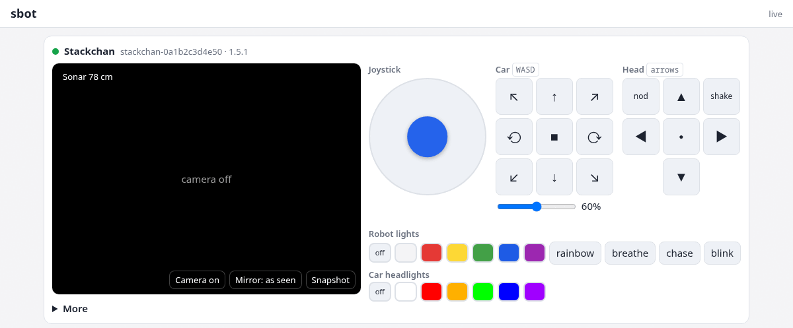

# sbot

An Embody Mode app server for a Stackchan and the devices that work with it. The first such device is an [ELECFREAKS TPBot](https://shop.elecfreaks.com/blogs/tutorials/tpbot-creative-programming-guide) car with a [micro:bit](https://microbit.org/), which runs [tpbot-ble](https://github.com/i41-eu/i41eu-tpbot-ble). On one page you see through Stackchan's camera and drive the car.



Part of [i41eu-arch](https://github.com/i41-eu/i41eu-arch), a local first, privacy first platform for a home: sbot grows into its home node (web/API server, event hub, controller server). The robot runs Embody Mode from the [i41eu-StackChan firmware](https://github.com/i41-eu/i41eu-StackChan), and the car's micro:bit runs [tpbot-ble](https://github.com/i41-eu/i41eu-tpbot-ble).

**Usually: the robot drives the car.** Stackchan connects to the car's micro:bit over BLE
itself, so everything runs on the robot's one Wi-Fi connection:

```
browser ⇄ HTTP + SSE ⇄ sbot ⇄ WS ⇄ Stackchan ⇄ BLE ⇄ micro:bit in the TPBot
```

**Optional: a bridge near the car.** When the car is out of the robot's BLE range, a
laptop or a Raspberry Pi close to the car runs `tpbot-bridge`, and the car becomes a
device of its own, linked to the robot:

```
browser ⇄ HTTP + SSE ⇄ sbot ⇄ WS ⇄ Stackchan
                        ⇅ WS
                   tpbot-bridge (laptop, Raspberry Pi…) ⇄ BLE ⇄ micro:bit in the TPBot
```

Every device is a `robot` worker of the [device wire protocol](https://github.com/i41-eu/i41eu-arch/blob/main/docs/wire-protocol.md), through the `wire` package of [q41eu-raw](https://github.com/i41-eu/q41eu-raw):

- **A worker that lists `car_*` commands has a car:** Stackchan with the car on, or `tpbot-bridge` (from [tpbot-ble](https://github.com/i41-eu/i41eu-tpbot-ble)). Both list the same commands and telemetry, so sbot does not care which one it is.
- **The Register label `with` = `<robot id>` links a device to a robot.** Browsers paired with that robot also see and control the device. The bridge sets it with `-with stackchan-…`.
- **The car is optional.** A Stackchan alone works, and so does a car alone (pair it with the URL the bridge logs).
- **Stackchan hosts the car** over BLE (firmware `CONFIG_STACKCHAN_EMBODY_CAR`). It lists `car_enable`, and the page shows a "Car: off / on" button. While on, it lists the `car_*` commands and telemetry plus `car_connected`. The car panel is live only while `car_connected` is 1. The micro:bit takes one BLE connection: to switch from a bridge to the robot, stop `tpbot-bridge` and disconnect its machine (`bluetoothctl disconnect <addr>`), because BlueZ keeps the link after the bridge exits.

> **A proof of concept, vibe coded.** Written with AI agents and tested on real hardware at
> home, but neither the code nor its security has been reviewed by humans. Use it on your
> own network, and don't trust it with anything private yet.
>
> **Early stage: no backward compatibility.** Protocols, APIs, file formats and stored settings
> change when something better comes along, without migrations: update the robot's firmware
> and the servers together.
>
> **Want more?** Ask in the [issues](https://github.com/i41-eu/q41eu-sbot/issues), and ideally [sponsor mj41](https://github.com/sponsors/mj41) on GitHub:
> mj41 codes for attention food.

## How the pieces fit

| Piece | What it is | Needed? |
|---|---|---|
| **Robot** | a Stackchan with the [Embody Mode firmware](https://github.com/i41-eu/i41eu-StackChan/tree/embody/firmware/main/apps/app_embody_mode). On its screen the **app switcher** (the QR screen: Next, Connect) lists its apps and switches between them; its gear opens the **Manager screen** (which manager it has, turn it off or on). | yes |
| **Apps** | what the robot does, one at a time. Each app is a web service: the robot connects to it, and a phone or browser opens its web page. This repo is Sbot, an app at home; the apps online: [s.i41.eu](https://s.i41.eu/#apps) | at least one |
| **Phone or browser** | opens an app's page and pairs with the robot by scanning its QR code; with end-to-end encryption only paired browsers can read the robot | to use an app |
| **Manager** | [i41eu-manager](https://github.com/i41-eu/i41eu-manager): the web service that sets robots up over USB, gives each robot its own token per app, and switches and changes apps from its page; on your own computer (the home manager) or online at [m.i41.eu](https://m.i41.eu), which a home manager may link to | optional: without it, apps are written over USB and switched on the robot's app switcher |

"Manager" always means this web service; on the robot there is only the app switcher and the
Manager screen that shows which manager it has.

## Run

```bash
go run ./cmd/sbot -loop-grant frown=emotion    # :8780, with the event hub
go run ./cmd/sbot-controller -mode shadow       # the loops, decisions only (live: they act)

# optional, a bridge near the car (when it is out of the robot's BLE range):
go install github.com/i41-eu/i41eu-tpbot-ble/cmd/tpbot-bridge@latest
tpbot-bridge -with stackchan-0a1b2c3d4e50
```

- **Setting up the robot:** with a Stackchan manager ([i41eu-manager](https://github.com/i41-eu/i41eu-manager)) at home, with sbot in its app catalog, as in [SETUP.md](https://github.com/i41-eu/i41eu-StackChan/blob/embody/firmware/main/apps/app_embody_mode/SETUP.md) in i41eu-StackChan; for the car: [Optional: drive a TPBot car](https://github.com/i41-eu/i41eu-StackChan/blob/embody/firmware/main/apps/app_embody_mode/SETUP.md#optional-drive-a-tpbot-car).
- **Getting the robot to sbot:** the manager writes sbot into the robot with the other apps you tick (catalog entry `{"id": "sbot", "name": "Sbot", "url": "ws://192.168.1.10:8780", "token_file": "<sbot's robot token file>"}`). On the robot: QR screen → Next until Sbot → Connect.
- **Pairing:** scan the robot's QR code, or type the 8-character code shown under it into the page. Pairing a Stackchan also gives access to the devices linked to it.
- **Leaving sbot:** "Move robot to" under the head buttons sends `server_switch`.
- Flags: `-listen` (`:8780`), `-public-url` (default `http://<LAN IP>:8780`), `-token-file` (q41eu-raw's robot token), `-pair-ttl` (`5m`), `-state-file` (`~/.local/state/sbot/state.json`, mode 0600: pairings, known robots, names, safety limits), `-ui-dir`; the hub: `-hub-dir` (`~/.local/state/sbot/hub`, `""` = no hub), `-hub-listen` (`127.0.0.1:4222`), `-hub-token-file` (`~/.config/sbot/hub-token`, made if missing, mode 0600), `-loop-grant loop=command,…` (repeatable).
- **Controller server:** `go run ./cmd/sbot-controller -mode replay|shadow|live|stats`.
- Tests: `go test -race ./...` (fake workers over real WebSockets: pairing through the host, command checks, the camera switching on only while watched, the state file).

## Event hub and controller server

sbot is the **web/API server** of the home node. Next to it run an **event hub** and a
**controller server** (i41eu-arch [architecture](https://github.com/i41-eu/i41eu-arch/blob/main/docs/architecture.md) §5–§7).

- **The hub** is NATS JetStream, embedded in sbot (`internal/hub`). It listens only on
  `127.0.0.1:4222`, with a token. Streams, 7 days each, size-capped:

  | Stream | Subjects | What |
  |---|---|---|
  | `TELEMETRY` | `telemetry.<device>` | measurements, at most one merged message per device per second |
  | `EVENTS` | `events.<device>.<name>` | device events, `online` / `offline` |
  | `COMMANDS` | `commands.<device>.<command>` | every command sent, with its `source` (`browser:<hash>`, `loop:<name>`, `server:safety`) and `cause` |
  | `DECISIONS` | `decisions.<maker>.<device>` | the safety stop's on/off (with the reading that caused it), loops' decisions |

  Every frame also goes to `live.telemetry.<device>` (not stored). Every event has an
  `id` (sortable), `ts`, `source`, `kind`, `device`, `name`, `data`, `cause`. Browsers
  appear as a hash of their session, never the session itself.
- **The controller server** (`cmd/sbot-controller`, `internal/loops`) runs loops as hub
  consumers, in `replay` (recorded events, sends nothing, prints what it would have
  done), `shadow` (live, decisions only) or `live` mode. Every loop goes replay → shadow
  → live.
- **Loops ask; sbot decides.** A loop's command is a request on
  `requests.commands.<device>`. sbot sends it only if the loop has a grant for that
  command (`-loop-grant`; none by default) and the normal checks pass, the safety stop
  included.
- **The first loop, `frown`:** the robot looks sad while its car is blocked and neutral
  when it is clear (grant: `frown=emotion`).
- **The safety stop stays in sbot.** Its command guard must decide before a command
  reaches the car, and safety must not depend on another process (principle: safety
  close to the hardware). It publishes its decisions for loops to use.

## Names

Each device has a name and a room (the first piece of the home model), set under
**More** on the page and kept in the state file. Pages and events show names, not ids.

## Page

- **Stackchan:** live camera (on only while someone watches), a head pad (left and right are the robot's own, as its camera shows them: ▶ and the → key turn the head to the robot's right), nod / shake / home, emotions, the LED strips, and moving the robot to another server.
- **Car:** a joystick (speed by distance from the center), a hold-to-drive pad and the WASD keys, where space stops; speed; headlights; sonar distance, line sensors, the micro:bit buttons, motor speeds, and the watchdog flag.
- **Events** from all visible devices, including the commands browsers sent. `car_drive` (10 per second while driving), `look` and `ping` are not listed.

**Safety stop** (`internal/app/safety.go`): no forward driving while the car's sonar sees something closer than the car's limit (default 10 cm; off, 5, 10, 15, 20 or 30 on the page, kept in the state file). A `car_drive` going forward on average, `(left + right) / 2 > 0`, is sent as `car_stop` instead (the answer is `{"status": "safety_stop", "cm", "limit_cm"}`). A car that reports moving forward inside the limit is stopped at once. Backward and turning on the spot stay allowed, so the car can always get away. The episode ends 3 cm past the limit, with one `safety_stop {cm, limit_cm}` event per episode. It uses only fresh readings (under 1.5 s) with an echo: with the sonar off, or nothing in range, there is no stop.

**Driving:** the page sends `car_drive` every 100 ms while a button or key is held, and `car_stop` on release. The micro:bit stops on its own 500 ms after the last `car_drive`, so a closed tab, a lost Wi-Fi link or a lost BLE link stops the car.

## Car capability

These are the names a car worker uses, whether it is the bridge or Stackchan.

| Command | Args |
|---|---|
| `car_drive` | `{"left", "right"}`: -100..100 |
| `car_stop` | none |
| `car_servo` | `{"port": 1..4, "angle": 0..180}` |
| `car_headlights` | `{"color": "#rrggbb"}` |
| `car_sonar` | `{"hz": 0..20}`: 0 = off |
| `car_watchdog` | `{"ms": 100..10000}` |
| `car_board` | `{"board": "v1"\|"v2"\|"both"}`: TPBot frame format (Stackchan only; the bridge has `-board`) |

Telemetry (raw values from the micro:bit): `car_echo_us` (sonar echo pulse, µs; 0 = none; cm ≈ µs / 58), `car_line_l` / `car_line_r` (pin levels), `car_btn_a` / `car_btn_b` (1 = pressed), `car_left` / `car_right` (motor speed in effect), `car_watchdog_stop` (1 = the watchdog stopped the motors), `car_uptime_ms`, `car_i2c_errors`, `car_board` (0 both, 1 V1, 2 V2). A Stackchan-hosted car adds `car_connected` (0/1) and `car_rssi_dbm`.

## API

Browsers need the `sbot_session` cookie of a session paired with the robot (or with the robot it belongs to).

| Endpoint | Purpose |
|---|---|
| `GET /pair?code=…` | QR target; pairs this browser with the robot |
| `GET /api/robots` | visible robots |
| `GET /api/events` | SSE: `robot` (full view), `telemetry` `{robot, m, ts}`, `robot_event` `{robot, name, data, sent, ts}` |
| `POST /api/robots/{id}/name` | `{"name", "room"}`: what people call the device |
| `POST /api/robots/{id}/safety` | `{"cm": 0\|5\|10\|15\|20\|30}`: the car's safety stop limit (0 = off) |
| `POST /api/robots/{id}/command` | `{"command", "args"}`; only commands the robot lists, never the server's own (`camera`, `mic`, `*_stream`) |
| `GET /api/robots/{id}/media?video=1` | WebSocket of binary camera frames (`0x01` + JPEG) |
| `GET /api/robots/{id}/snapshot` | the latest full-resolution still (JPEG) after a `snapshot` command |
| `GET /healthz` | `ok`, for health checks |

## Status

Proof of concept, tested on real hardware on a LAN: the micro:bit in the TPBot, driven from the browser through `tpbot-bridge` and through Stackchan itself over BLE; the safety stop; the event hub, with the `frown` loop live.

- **Trust:** sbot accepts only the shared robot token (q41eu-raw also has per-robot tokens). Any worker with the token can claim `with` = any robot id. The `with` link should later be granted by the owner ([trust design](https://github.com/i41-eu/i41eu-arch/blob/main/docs/implementations/stackchan-trust.md)).
- **Next:** the home model with Home Assistant as a source, and more loops: i41eu-arch [fit and roadmap](https://github.com/i41-eu/i41eu-arch/blob/main/docs/fit-and-roadmap.md).

## Related projects

- [i41eu-arch](https://github.com/i41-eu/i41eu-arch): the vision, use cases and architecture that sbot grows into, and the device wire protocol. All the repos: [The repos today](https://github.com/i41-eu/i41eu-arch#the-repos-today).
- [i41eu-StackChan](https://github.com/i41-eu/i41eu-StackChan): the robot's firmware with Embody Mode, which can host the car over BLE.
- [tpbot-ble](https://github.com/i41-eu/i41eu-tpbot-ble): the car's micro:bit firmware and `tpbot-bridge`.
- [q41eu-raw](https://github.com/i41-eu/q41eu-raw): the `wire` package sbot uses, and the full Stackchan dashboard.
- The Stackchan [trust design](https://github.com/i41-eu/i41eu-arch/blob/main/docs/implementations/stackchan-trust.md).

Stack-chan (スタックチャン) was created by Shinya Ishikawa and the Stack-chan community ([github.com/stack-chan/stack-chan](https://github.com/stack-chan/stack-chan)); this project is independent of it and of M5Stack.

## License

Apache License 2.0, see [LICENSE](LICENSE).
